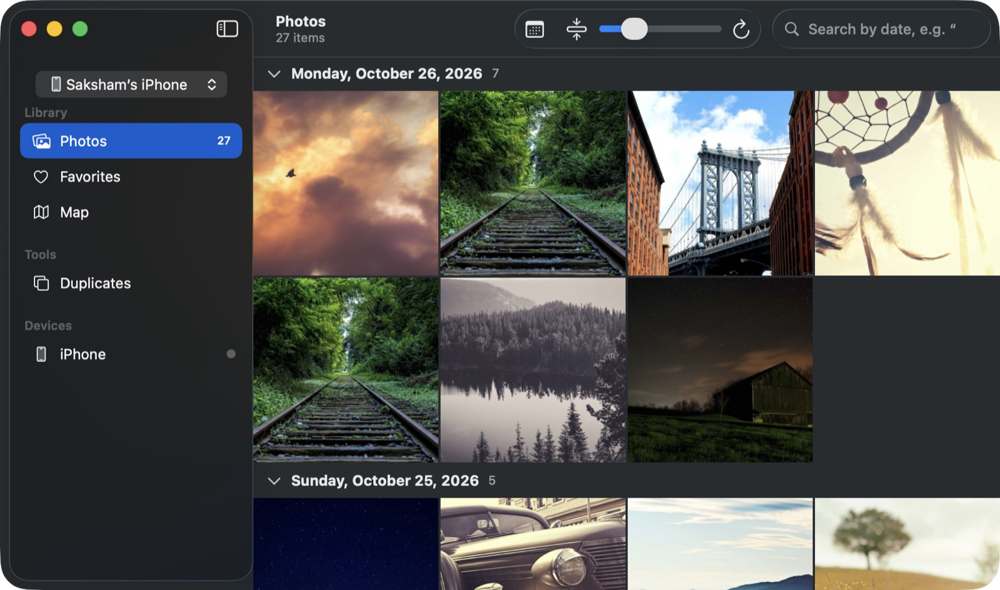

# PhotoVault

A native macOS app that backs up the photos and videos from your iPhone's camera roll to a folder on your Mac, as untouched originals, and lets you browse the backup in a Photos-style gallery.

> **Install:** download `PhotoVault-1.0.0.dmg` from [Releases](https://github.com/sakshammalge/photovault-mac/releases), drag PhotoVault to Applications, then right-click it and choose **Open** the first time (see [Gatekeeper](#gatekeeper)).



## Features

- [x] Detect an iPhone plugged in over USB (ImageCaptureCore)
- [x] List every photo and video with name, date, size and type
- [x] Incremental backup into `~/Pictures/{device name}`, one folder per iPhone
- [x] Gallery for the backup folder (grouped by day, cached thumbnails, full-screen viewer, video, Live Photos)
- [x] Auto-backup on connect, with a notification when it finishes
- [x] Packaged as a signed-ad-hoc `.app` / `.dmg`
- [x] Favorites, search, map and duplicate finder

## Gatekeeper

Release builds are **ad-hoc signed, not notarized** (no Apple Developer ID). On first launch macOS will say the app can't be verified. Right-click the app, choose **Open**, then **Open** again; or run `xattr -dr com.apple.quarantine /Applications/PhotoVault.app`. Building from source avoids the prompt entirely.

## Build and package

Requires macOS 13+ and Xcode or the command line tools.

```sh
scripts/package.sh              # universal (arm64 + x86_64)
scripts/package.sh --arm64-only
```

This produces `dist/PhotoVault.app`, `PhotoVault-<version>.dmg`, `.zip` and `SHA256SUMS.txt`. The version comes from `Support/Info.plist`.

## Privacy and safety

- Everything stays on your Mac. PhotoVault makes no network requests and has no analytics.
- It only reads from the iPhone; nothing on the phone is changed or deleted.
- It never overwrites or deletes files in your backup folder.
- The app asks for access to connected devices (camera/USB prompt) and, optionally, permission to send notifications.

## Run from source

Requires macOS 13+ and Xcode (or the Xcode command line tools).

```sh
swift run
```

Or open `Package.swift` in Xcode and press Run.

Then plug in your iPhone, unlock it, and tap **Trust** if asked. The first time, macOS may ask for permission to access connected devices.

The app asks the phone for original files (`mediaPresentation = .originalAssets`), so HEIC stays HEIC and nothing gets converted. Photos whose originals live only in iCloud ("Optimize iPhone Storage") aren't on the phone and won't show up.

## How the backup works

- Press **Back Up N New Items**. Only items not already in the backup are copied, oldest first.
- Each iPhone has its own folder, `~/Pictures/{device name}/YEAR/MONTH/`, found again by its serial number so a renamed phone keeps its folder. The device menu at the top of the sidebar picks whose backup the gallery, favorites, map and duplicates views show.
- Files go into that folder, keeping the phone's file names and capture dates. Live Photo videos and edit files (`.AAE`) are copied next to their photo.
- Each file is downloaded into `.photovault/incoming/` first and only moved into place once its size matches the phone's. Nothing is ever overwritten; a name clash gets a ` (2)` suffix.
- What has been backed up is recorded in `.photovault/index.json`, so a stopped or failed backup picks up where it left off. Files you already copied into the folder with the same name and size are recognised and not downloaded again.
- Nothing on the phone is changed or deleted.

## Existing IphoneBackup folder

If `~/Pictures/IphoneBackup` exists from an earlier version, it appears in the device menu as is. The first time a phone connects, PhotoVault asks whether to use that folder for the phone (no files are moved) or to start a new `~/Pictures/{device name}` folder.

## Auto-backup

When the iPhone is connected, unlocked and trusted, and its camera roll has been read, PhotoVault starts the incremental backup by itself, once per connection, and posts a notification when it finishes (item count, or how many failed). Turn it off with the checkbox on the device screen; the choice is remembered. Under `swift run` the notification is sent via `osascript` and may appear as "Script Editor"; from the packaged .app it uses the normal notification centre.

## Gallery

The **Gallery** tab shows everything in the backup folder, newest first, grouped by day. It reads the folder directly, so it works without the phone connected.

- Thumbnails are cached in memory and in `.photovault/thumbs/`; the slider in the toolbar changes their size.
- Click a photo or video to open it full window. Left/right arrows move between items, Esc closes. HEIC opens like any other photo.
- A video saved next to a photo with the same name is treated as that photo's Live Photo clip: it is hidden from the grid and plays from the LIVE button in the viewer.
- The gallery only reads your original files; the only thing it writes is the thumbnail cache.

## App icon

Source art is `Support/AppIcon/AppIcon.svg`. `node Support/AppIcon/build.js` (needs `playwright`) regenerates `AppIcon.appiconset` (Xcode asset catalog) and `AppIcon.icns`.

## License

[MIT](LICENSE)

## Screenshots

The screenshot above was taken in demo mode, which shows a folder of stock photos and never touches a phone or your saved settings:

```sh
PHOTOVAULT_DEMO_FOLDER="$HOME/some/folder" PHOTOVAULT_DEMO_SECTION=gallery .build/release/PhotoVault
```
